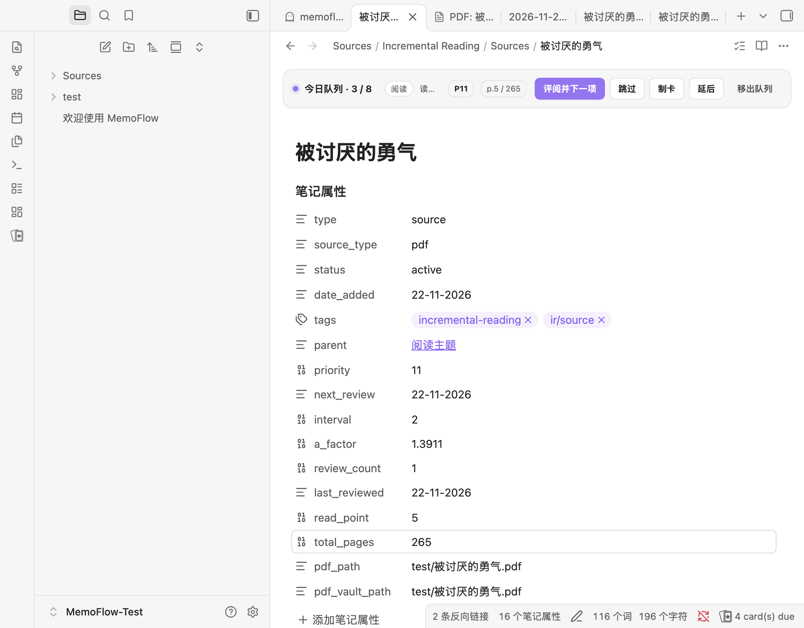
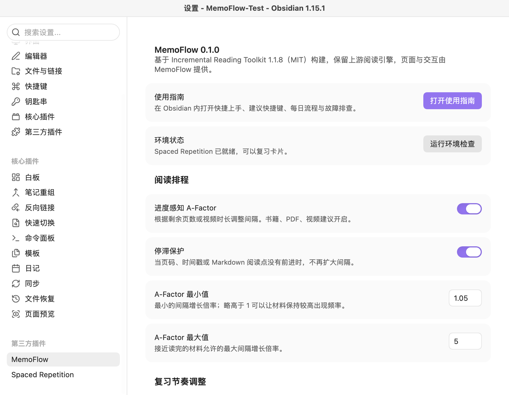
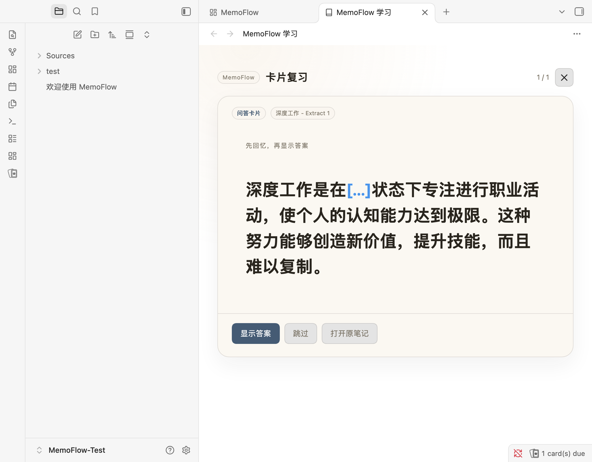
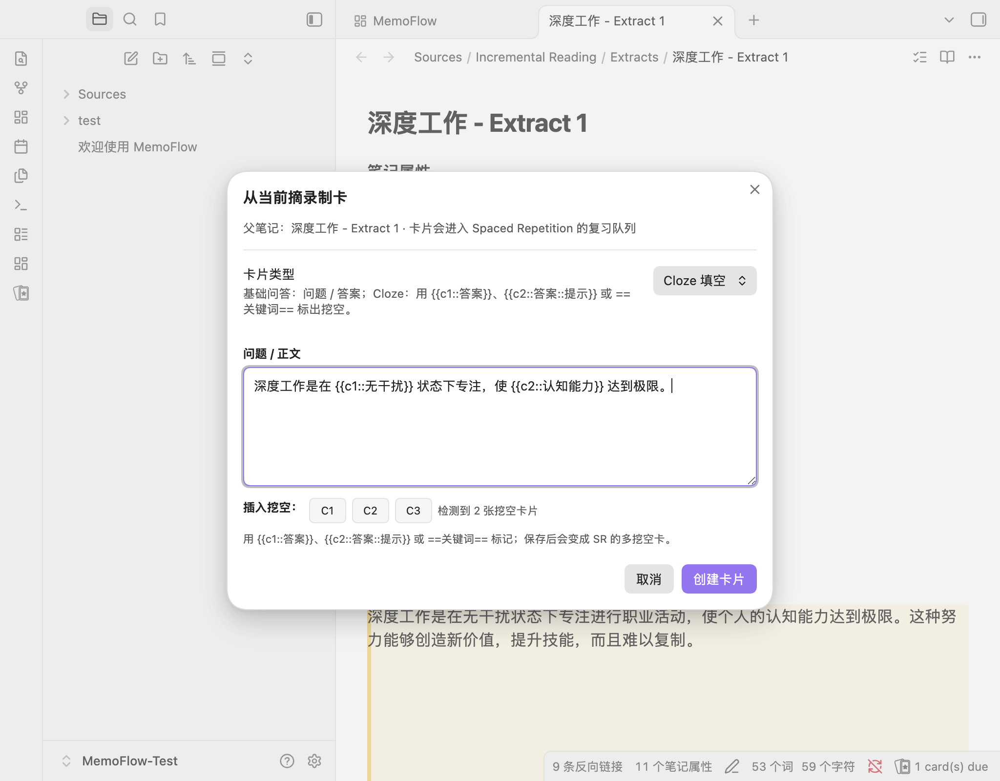

# MemoFlow

MemoFlow 是一个以 **SuperMemo 增量阅读工作流** 为目标、在 Obsidian 里运行的插件。它 fork 自 [Incremental Reading Toolkit 1.1.8](https://github.com/kja140/incremental-reading)（MIT），保留上游的 A-Factor 主题调度、摘录、知识树、队列与 Spaced Repetition 集成，并在上面重建一个纸墨风的「今日学习」总览台。

> **个人自用项目，不发布。** 作者：**三斤的多多 / DeepSeek**。当前阶段 v0.1.0：个人每日增量阅读与 SR 复习可用；移动端尚未实机验收。

> 上游 Incremental Reading Toolkit 1.1.8（MIT）的调度引擎与版权署名保留；MemoFlow 只服务个人学习工作流。


## 现在能做什么

- 一屏看到今日待读、逾期、新素材、卡片数量与今日进度。
- 优先级队列：按紧急度 / 优先级 / 到期日排序，按阅读、摘录、卡片、逾期筛选。
- 知识树、未来 7 天负荷、学习节奏、最近摘录、阅读中的 PDF 来源。
- 一键「开始今日学习」按 session 打开实际内容、打开阅读队列/知识树、从剪贴板制卡、摘录选中文字。
- 示例数据模式；测试 Vault 与浏览器预览。
- **阅读中的操作条**：完成并下一项、跳过（保留在队列）、延后 1/3/7 天、移出队列；标题栏也有「MemoFlow 阅读操作」入口。
- **时间戳摘录**：从选中内容或剪贴板生成 `YYYY-MM-DD HH-mm-ss` 命名的摘录，底部自动带 `[[PDF#page=N]]` 来源链接。
- **完整中文界面**：设置页、命令、顶层菜单、阅读/评分提示、确认框、选择项、使用指南与正常流程 Notice 已中文化；A-Factor、FSRS、Spaced Repetition 等技术词保留。
- **开始学习 / 卡片复习**：「开始今日学习」按 session 打开实际内容；「卡片复习」只复习问答/Cloze 卡片。
- **卡片闭环**：从当前摘录制作基础问答或 Cloze 卡片 → Spaced Repetition 复习 → 回到阅读条「下一项」。
- **C1/C2/C3 挖空**：制卡弹窗支持 `{{c1::答案}}`、`{{c2::答案::提示}}` 或 `==关键词==`，C1/C2/C3 会生成不同挖空卡；基础问答是独立卡片。
- **双向/图片/遮挡卡**：制卡弹窗支持双向问答；图片卡、图片遮挡沿用上游编辑器入口；卡片仍进入同一个 SR deck。
- **优先级与阅读点**：阅读条显示 `P11` 和 `p.5 / 265`；点优先级可设置 / 快速提升，点页码打开 PDF 阅读点。
- **过载处理**：总览页「过载处理」用 Mercy 把逾期主题摊平到未来 3 / 7 / 14 / 30 天；设置里可开启自动 Mercy（逾期超过阈值时，开始学习前自动按 7 天摊平）。
- **队列内优先级**：总览队列每行的 `P8` 可直接点开修改，保存后行内数字立即更新。
- **子集复习**：队列按类型/逾期/搜索筛选后，点「复习筛选（N）」只把当前筛选结果组成 session。








## 阅读中的操作条

从 PDF/笔记回到文件列表后打开，或在文件列表里打开当天 session 中的来源/摘录后，笔记顶部会出现：

`今日队列 · 2 / 7` · `摘录` · `完成并下一项` · `跳过` · `延后` · `移出队列`

- 摘录的「完成并下一项」= 标记 done + 从 session 移除 + 打开下一项；
- 来源的「评阅并下一项」= 走上游的页码/间隔评阅，再打开下一项；
- 「跳过」只前进，不标记，也不把它移出队列；
- 「延后」提供 +1 / +3 / +7 天，并自动进入下一项；
- 「移出队列」标记 dismissed 并前进；
- 阅读视图/实时预览都可用；标题栏的列表图标也打开同一组操作（含「仅标记完成」「打开 MemoFlow 总览」）。
- 卡片笔记会显示「下一项 / 复习此卡」；卡片评分仍由 Spaced Repetition 负责。

## 开始学习 / 卡片复习

两个入口，共用同一套纸墨设计：

- **开始今日学习**（或命令「开始学习」）：按今日 session 逐项打开**实际内容**。
  - PDF 来源：用 **Obsidian 原生 PDF 阅读器**打开 `pdf_vault_path#page=read_point`；PDF 顶部有横向 MemoFlow 功能栏（阅读阶段：剪贴摘录 / 完成阅读 / 下一项 / 更多；制卡灰显）；
  - Markdown 来源/摘录：打开笔记，顶部保留完整阅读条（制卡 / 完成并下一项 / 跳过 / 延后 / 移出）；
  - 问答卡片：打开卡片笔记；顶部只保留卡片动作，制卡/完成等主题按钮置灰；
- **卡片复习**（或命令「卡片复习」）：只取今天到期的问答 / Cloze 卡片，用统一卡片页复习。

卡片评分仍由 Spaced Repetition 负责；卡片复习页会在后台建立 SR 会话、隐藏其弹窗、调用 SR 的评分入口。一个卡片笔记里如果有 C1/C2/C3 多张卡，会按顺序逐张复习，再进入下一项。

> 这个桥接固定验证 SR `1.15.4`。未来 SR 大版本若改内部 `contentManager` 接口，需要更新桥接或退回 SR 弹窗。

## 卡片闭环（需要 Spaced Repetition）

卡片调度交给 [Spaced Repetition](https://github.com/st3v3nmw/obsidian-spaced-repetition)，MemoFlow 不重写 FSRS。

- 在来源/摘录的阅读条点「制卡」，或命令面板搜索「从当前摘录制卡」；
- 支持基础问答与 `==关键词==` Cloze；
- 卡片自动带 `source` 链接和 `flashcards/incremental-reading` tag，进入 SR 的 deck；
- 卡片阅读条显示「复习此卡 / 下一项」；总览页显示「卡片待复习」，并提供「卡片复习」入口；
- 未安装 SR 时仍可制卡，但复习按钮会提示先安装；总览统计显示 `—`。

安装、tag 配置与回滚见 [docs/SR-SETUP.md](docs/SR-SETUP.md)。

## 中文界面

- 设置 → MemoFlow：全部中文，包括阅读排程、队列、内联卡片、SR、知识树、路径、通用；
- 阅读提示：页码、Topic quality（保持/提前/推后）、优先级、延后、来源类型、总页数、制卡/遮挡等提示和按钮都是中文；
- 确认框、选择列表、使用指南已中文化；
- 命令面板：`构建今日学习队列`、`下一项`、`评阅当前阅读项`、`从选中内容摘录`、`从剪贴板制卡`、`采集或新建…`、`当前阅读项操作…`、`打开 MemoFlow 视图…`、`高级工具…`、`从当前摘录制卡`、`生成时间戳摘录`；
- 顶层操作菜单同样中文；命令 ID 不变，原快捷键继续有效；
- 构建时通过 `src/i18n/base-zh.json` + `src/i18n/base-zh.js` 只替换上游的用户可见字符串，调度逻辑保持不变；
- 仍保留英文的范围：开发者控制台的诊断/异常堆栈、第三方 Spaced Repetition 自身界面、Obsidian 核心 UI。

## C1/C2/C3 挖空



在摘录阅读条点「制卡」→ 选「Cloze 填空」：

- 可直接写 `{{c1::答案}}`、`{{c2::答案::提示}}`；
- 也可用 `==关键词==` 写单挖空；
- 弹窗提供 C1 / C2 / C3 插入按钮和「检测到 N 张挖空卡片」计数；
- 保存时转换成 SR 的 `==1;;答案==` / `==2;;答案;;提示==` 语法；
- C1/C2/C3 是同一篇卡片笔记里的不同卡，卡片复习会逐张出题；
- 同一段内容想要问答卡，再建一张「基础问答」卡即可（Anki 的 cloze 与 basic 也是两个 note 类型）。

## 剪贴摘录

### 剪贴摘录（当前主流程，平板也能用）

1. 在 Obsidian 原生 PDF 中选中文字并复制；
2. 点 PDF 功能栏「剪贴摘录」，或命令「从剪贴板生成摘录」；
3. 后台生成摘录，不打开新标签；
4. 弹出小确认：
   - **留在当前**：继续停在 PDF；
   - **在新标签页打开**：打开刚生成的摘录；
5. 页码优先级：剪贴板里的 `#page=` 链接 > 当前 PDF 页 > `read_point`；平板复制纯文字也能拿到当前页。

桌面和平板都用这一条，不依赖任何 PDF 高亮插件。

## 完整 SuperMemo 工作流（测试 Vault）

当前测试库已经按下面这条链路跑通：

1. **导入书籍**：`npm run seed:book` 会把 `插件开发/书籍/被讨厌的勇气.pdf` 复制到测试库，并创建 265 页的 `被讨厌的勇气` 来源；
2. **进入每日流**：ribbon 打开总览 → 开始今日学习；来源/摘录按优先级和到期日排进 session，PDF 来源直接用 Obsidian 原生阅读器打开；
3. **阅读并保留阅读点**：打开来源，顶部显示 `P11`、`p.5 / 265`；点「评阅并下一项」会问你读到的页码，写入 `read_point`，再打开下一项；
4. **摘录**：命令「生成时间戳摘录」或选中文字；新摘录带 `**来源**：[[...pdf#page=5|被讨厌的勇气 · p.5]]`；可打开原笔记继续处理；
5. **制卡**：在摘录阅读条或来源菜单点「制卡」，可选基础问答 / Cloze（C1/C2/C3）；卡片进入 SR deck；
6. **复习**：在开始学习或卡片复习里显示答案 → 评分；SR 写回 `<!--SR:...-->`；
7. **优先级**：点阅读条 `P11`，可设 P1–P100 或快速提升 5 / 15 / 30；
8. **过载**：总览页「过载处理」→ 选 Mercy 窗口，逾期主题被摊平，逾期数归零。

更细的复现步骤与预期结果见 [docs/WORKFLOW-TEST.md](docs/WORKFLOW-TEST.md)。

个人日常流程与备份见 [docs/PERSONAL-CHEATSHEET.md](docs/PERSONAL-CHEATSHEET.md)；改动后的手动验收见 [docs/PERSONAL-SMOKE.md](docs/PERSONAL-SMOKE.md)。

## 时间戳摘录

命令面板搜索「生成时间戳摘录（选中 / 剪贴板）」，或点总览页「快速开始 → 摘录选中 / 剪贴板」。

- 文件名：`2026-11-22 04-13-05.md`（可随时重命名；调度字段不受影响）；
- 内容：选中的文字或剪贴板文本；
- frontmatter：`source`、`page`、优先级、下次复习、interval、tag；
- 页脚：`**来源**：[[test/学会提问.pdf#page=96|学会提问 · p.96]]`，点击回到 PDF 对应页；
- 页码优先从剪贴板的 `#page=` 链接中解析，其次当前 PDF 页，最后回退到来源的 `read_point`。

> 上游原有的「Extract selection / Extract clipboard」命令仍然保留，只是仍使用 “来源名 - Extract N” 命名；新的时间戳入口是独立命令，不影响旧流程。

## 平台

| 平台 | 状态 |
|---|---|
| macOS | 已验收（桌面端） |
| Windows / Windows 平板 | 代码层无平台特定阻塞；需按 `docs/MOBILE-CHECKLIST.md` 在 Windows 实机验收 |
| iPadOS / Android | 插件可加载（`isDesktopOnly: false`）；页面、队列、知识树、摘要可触控使用 |
| 移动端 PDF | 仅 **Vault 内 PDF + 页码跳转**；Vault 外 PDF 会提示设置 `pdf_vault_path` |
| 移动端选区 | 不做字形级绑定；平板用「剪贴摘录」fallback，页码取当前 PDF 页，找不到再回退 read_point |

## 安装（测试 Vault）

```bash
# 在仓库根目录
node scripts/seed-test-vault.mjs
node scripts/seed-book-workflow.mjs   # 可选：把《被讨厌的勇气》复制进测试库并建来源
node scripts/build.mjs --install-test
```

然后用 Obsidian「打开文件夹作为 Vault」选择 `MemoFlow-Test/`，在设置 → 第三方插件中启用 **MemoFlow** 与 **Spaced Repetition**（测试 Vault 已装 SR 1.15.4）。测试库里另有一个 265 页的 `被讨厌的勇气` 来源，专门用于跑完整工作流；它来自 `插件开发/书籍/`，不会碰 HWP 知识仓库或真实 `supermemo` 库。

> ⚠️ 不要同时启用原来的 `incremental-reading-toolkit` 和 `memoflow`：两者注册的 Obsidian 视图类型是全局的，会冲突。测试 Vault 只启用 MemoFlow。

## 安装（已有 Vault）

1. 备份 `<vault>/.obsidian/plugins/incremental-reading-toolkit/`（如果已安装上游插件）。
2. 把 `dist/memoflow/` 里的 `main.js`、`manifest.json`、`styles.css` 复制到 `<vault>/.obsidian/plugins/memoflow/`。
3. 在 Obsidian 第三方插件中启用 **MemoFlow**；如果同时启用了上游插件，先停用它。
4. 手机/平板 Obsidian 版本需 ≥ 1.12.7；Vault 内 PDF 请给来源同时写 `pdf_vault_path`。

## 构建与验证

需要 Node ≥ 18；开发期使用本机 DSH 自带的 Node/pnpm。首次构建先安装 esbuild：

```bash
pnpm install        # 或 npm install；只装 esbuild 开发依赖
node scripts/build.mjs            # 构建 dist/memoflow
node scripts/build.mjs --preview  # 构建浏览器预览 preview/app.js
node scripts/build.mjs --preview --install-test
node scripts/build.mjs && node --test test/*.test.js && node scripts/validate-memoflow.mjs
node scripts/screenshot.mjs       # Edge headless 生成亮/暗/窄屏截图
```

`package.json` 中的等价脚本：

```bash
node scripts/build.mjs
node --test test/*.test.js
node scripts/validate-memoflow.mjs
```

构建产物 `dist/memoflow/main.js` 是 esbuild 打包后的 CJS；上游源文件 `main.js`、`*-core.js`、测试与 `styles.css` 保持 1.1.8 原样。新增 UI/数据层全部在 `src/`；构建时由 esbuild 插件只替换上游的用户可见字符串（`src/i18n/base-zh.js`），不修改调度逻辑。

## 浏览器预览

`preview/index.html` 可直接打开，或用本地静态服务：

```bash
python3 -m http.server 8080
# http://localhost:8080/preview/index.html
```

支持 `?theme=dark`、`?empty=1`、`?w=390`（固定宽度模拟手机）、`?bare=1`。

## 与上游的关系

- 上游：`kja140/incremental-reading`，tag `1.1.8`，commit `9875675ef419c280ed2bc894d0d6259bcc617c78`。
- LICENSE 保留 MIT 与上游版权声明；README 下方保留上游文档。
- 上游的调度算法、Spaced Repetition 集成、知识树、队列、PDF 视图均未改写；设置页由 MemoFlow 的 `src/views/settings-tab.js` 以中文重写，命令名/顶层菜单通过子类覆盖中文化。
- 本 fork 新增：`src/` 页面层、中文设置页/命令/菜单/提示/使用指南、阅读操作条与标题栏入口、时间戳摘录与 PDF 页码引用、摘录制卡/Cloze 卡片、卡片待复习统计、队列优先级、子集复习、自动过载、开始学习/卡片复习、剪贴板摘录、`plugin/manifest.json`（`memoflow`，`isDesktopOnly:false`）、移动端 Vault 内 PDF 守卫、预览与测试 Vault。

---

## Upstream documentation (Incremental Reading Toolkit 1.1.8)

<p align="center">
  
</p>

<h1 align="center">Incremental Reading Toolkit</h1>

<p align="center">
  Turn long-form reading into scheduled topics, focused extracts, and durable flashcards—without leaving Obsidian.
</p>

<p align="center">
  <a href="https://incremental-reading.kjames.xyz/">Documentation</a>
  · <a href="docs/USER-GUIDE.md">User guide</a>
  · <a href="https://github.com/kja140/incremental-reading/releases">Releases</a>
  · <a href="CHANGELOG.md">Changelog</a>
</p>

<p align="center">
  
  
  
</p>

---

Incremental Reading Toolkit helps you read long sources a little at a time, revisit them on a useful schedule, extract the parts that matter, and turn those extracts into flashcards. It works with Markdown notes, PDFs, clipboard content, and images.

Topic scheduling uses a progress-aware **A-Factor**. Flashcard scheduling and grading are handled by the actively maintained [Spaced Repetition](https://github.com/st3v3nmw/obsidian-spaced-repetition) community plugin.

> [!IMPORTANT]
> MemoFlow sets `isDesktopOnly: false`. On mobile it can open vault PDFs at a page through Obsidian's native viewer; external filesystem PDFs and selection-level extraction are desktop/experimental only. See `docs/MOBILE-CHECKLIST.md`.

## At a glance

| Material | Role in the workflow | Scheduling |
|:--|:--|:--|
| 📖 **Sources** | Articles, books, videos, and long notes you revisit in portions | Reading queue + A-Factor |
| ✂️ **Extracts** | Focused passages linked back to their parent source | Reading queue + A-Factor |
| 🃏 **Cards** | Native Markdown flashcards in `#flashcards/incremental-reading` | Spaced Repetition plugin |

```text
Source → Read a portion → Extract the useful part → Make a card → Review
   ↑              A-Factor schedules topics              Spaced Repetition ↑
```

## Highlights

| | Feature | What it gives you |
|:--:|:--|:--|
| 🔀 | **Mixed learning queue** | Alternates priority-aware reading topics with Spaced Repetition card notes. |
| 🧠 | **Progress-aware scheduling** | Recomputes topic intervals from remaining pages or seconds, with pace controls and a stall guard. |
| ✂️ | **Fast capture** | Creates extracts from selected text, the clipboard, or a PDF and links them to their parent. |
| 🃏 | **Flexible flashcards** | Creates cards from text, images, inline syntax, and image occlusion. |
| 🌳 | **Knowledge tree** | Shows source and extract relationships with filtering, ordering, and drag-to-reparent. |
| 📋 | **Reading queue** | Keeps today’s session, overdue work, new material, and active topics visible in the sidebar. |
| 📊 | **Analytics dashboard** | Shows session health, a 14-day review graph, queue workload, collection mix, and lifetime totals. |
| 📄 | **Integrated PDF reader** | Opens vault or external PDFs with page navigation and saved read points. |

Inline-card export understands `Q:: … ::A::`, `{{c1::…}}`, and `==highlight==` syntax and converts it into native Spaced Repetition card notes.

## Installation

### Community Plugins

1. Open **Settings → Community plugins** in Obsidian.
2. Install and enable **Spaced Repetition**.
3. Search for **Incremental Reading Toolkit**, then install and enable it.
4. Run **Incremental Reading Toolkit: Run setup check** from the plugin settings.

Card creation writes Spaced Repetition-compatible Markdown. Topic scheduling remains available if Spaced Repetition is missing, and card-review commands will show an installation reminder.

### Manual installation

1. Download `main.js`, `manifest.json`, and `styles.css` from the latest [release](https://github.com/kja140/incremental-reading/releases).
2. Copy them into `<vault>/.obsidian/plugins/incremental-reading-toolkit/`.
3. Install and enable **Spaced Repetition**.
4. Reload Obsidian, then enable **Incremental Reading Toolkit**.

## Five-minute workflow

1. **Capture a source.** Open **Capture or create…**, then choose **Import clipping (active note)** or **New source**.
2. **Build the queue.** Run **Build today's session queue** once, then run **Next element**.
3. **Keep the valuable parts.** Select important text and run **Extract selection**.
4. **Schedule the return.** Leave the cursor where you stopped, then run **Grade current reading topic**.
5. **Create recall material.** Run **Flashcard from clipboard**. When **Next element** opens a card note, Spaced Repetition starts automatically and the accepted review finishes that queue entry.

For recommended keybindings and complete note, PDF, card, queue, and date workflows, open the [user guide](docs/USER-GUIDE.md). You can also run **Open user guide** inside Obsidian.

> [!NOTE]
> Upgrading from a pre-release development build? Open **Advanced tools…** and run **Migrate legacy cards to Spaced Repetition** once. It preserves card content and source links while replacing legacy scheduling fields.

## Command reference

| Command | Purpose |
|:--|:--|
| **Build today's session queue** | Explicitly calculate and save today's scheduled queue. |
| **Next element** | Open the following saved queue path without recalculating collection views; automatically start SR when it is a card. |
| **Grade current reading topic** | Grade and schedule the current source or extract without navigating. Cards finish automatically in SR. |
| **Extract selection** | Turn selected source text into a linked extract. |
| **Flashcard from clipboard** | Create a native Spaced Repetition card from clipboard text. |
| **Capture or create…** | New/imported sources, PDF-aware extracts, image cards, image extracts, and occlusions. |
| **Current element actions…** | Done/reset (including cards), dismiss, postpone, schedule, priority, parent/PDF navigation, read points, and checkpoints. |
| **Open Toolkit view…** | Dashboard, analytics, queue, knowledge tree, or user guide. |
| **Advanced tools…** | Subset/overload tools, splits, tree editing, migration, inline-card export, and diagnostics. |

## Settings

Settings are grouped by workflow and include plain-language descriptions.

| Section | Configure |
|:--|:--|
| **Scheduling** | Reading intervals, progress awareness, A-Factor bounds, pace adjustments, and the stall guard. |
| **Queue** | Mixed-card behaviour, ordering, filters, and session display. |
| **Inline cards** | Question/answer and cloze parsing patterns. |
| **Spaced Repetition** | Dependency status, deck tag, and multiline card separators. |
| **Knowledge tree** | Multi-select Done/Reset actions, branch warnings, completion visibility, and expansion state. |
| **Paths** | Every plugin-managed source, extract, card, category, attachment, dashboard, and log path. |
| **General** | Date convention, extract highlight colour, and diagnostic logging. |

Use **Run setup check** at the top of the settings page to verify the Spaced Repetition dependency, folder separation, A-Factor bounds, and card separators. Each path setting has a reset-to-default button. Configure card algorithms and review behaviour in Spaced Repetition itself.

## Privacy and permissions

Incremental Reading Toolkit is local-first: no telemetry, advertisements, account requirement, or built-in update mechanism.

| Permission | Behaviour |
|:--|:--|
| **Clipboard** | Reads text or images only after you run a clipboard capture command. |
| **External files** | Reads only the local PDF stored in the active source’s `pdf_path`; it does not modify the PDF. EPUB is not supported. |
| **Network** | Makes no plugin-initiated network requests. Opening a YouTube embed allows Obsidian to connect to YouTube. |
| **Vault** | Enumerates configured toolkit folders and writes only to configured plugin paths. Migrations require an explicit command. |

## Design lineage

The toolkit is inspired by [SuperMemo’s incremental reading](https://help.supermemo.org/wiki/Incremental_reading) workflow and [bjsi’s Incremental Writing plugin](https://github.com/bjsi/incremental-writing) for Obsidian.

SuperMemo established the model of importing sources, revisiting prioritized portions, extracting important material, and turning it into durable question-and-answer knowledge. Incremental Writing demonstrated how prioritized, scheduled queues can feel native inside an Obsidian vault.

This is an independent plugin and is not affiliated with or endorsed by SuperMemo or the Incremental Writing project. See [SuperMemo workflow alignment](docs/SUPERMEMO-ALIGNMENT.md) for a feature-by-feature comparison and the intentional differences.

## Development

```bash
npm install
npm run check
```

`main.js` is the shipped plugin. `tree-core.js` contains the pure, Obsidian-free tree logic that is unit-tested and inlined into `main.js`; a regression test keeps both copies synchronized.

See [RELEASING.md](RELEASING.md) for the release and Community Plugins submission checklist.

## License

Released under the [MIT License](LICENSE).
